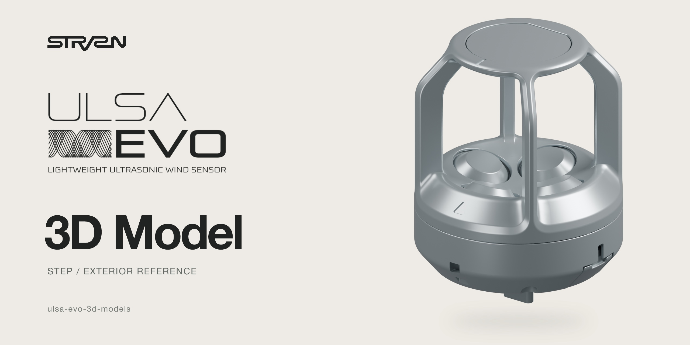
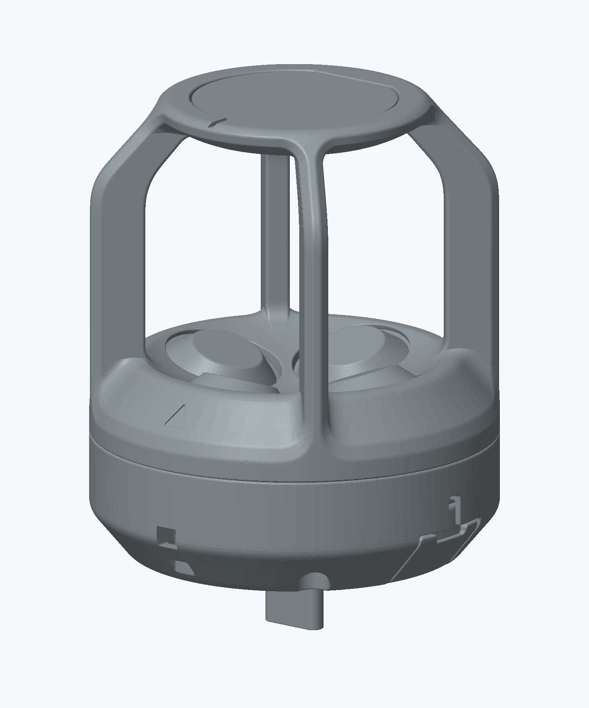

# ULSA EVO — 外形参照用3Dモデル

[日本語](#日本語) · [English](#english)

## 日本語

[製品サイト](https://ulsa-evo.strvsn.net/) · [配布パッケージ](https://github.com/strvsn/ulsa-evo-3d-models/releases/latest)

StratoVision LLC.の超音波風速センサー **ULSA EVO** の簡易外形モデルです。設置スペース、独立した周辺機器の設計、画像・動画制作などに利用できます。

**外形参照用のデータです。** 製造図面やオープンソースハードウェア設計データではありません。重要な寸法・接続部は実機と最新の正規製品資料で確認してください。

### ダウンロード

- [STEPモデル](models/ULSA_EVO_Exterior_Reference.step) — CAD向けソリッド
- [STLモデル](models/ULSA_EVO_Exterior_Reference.stl) — mm単位で読み込み
- [3MFモデル](models/ULSA_EVO_Exterior_Reference.3mf) — 単位を含むメッシュ
- [USDZモデル](models/ULSA_EVO_Exterior_Reference.usdz) — Apple系ビューアー・AR向け
- [ライセンス・注意事項を含む配布パッケージ](https://github.com/strvsn/ulsa-evo-3d-models/releases/latest)
- [モデルの説明](docs/MODEL_NOTES.md)・[ファイル情報](model-manifest.json)

各モデルのページで **Download raw file** またはダウンロードボタンを選ぶと保存できます。配布パッケージには4形式とライセンス・注意事項を同梱しています。再配布時にもライセンス・注意事項を添付してください。

STL・3MFはZ上向き、USDZはY上向きです。STLはmm単位で読み込んでください。メッシュ形式はSTEPから変換した近似形状です。用途別の座標・単位は[モデルの説明](docs/MODEL_NOTES.md)を参照してください。

### 用途と留意事項

外形の収まり、設置スペース、独立した周辺機器の設計、画像・動画制作、許諾された非機能モックアップに利用できます。寸法、公差、ねじ、材質、質量、重心、強度、気流やセンサー性能を保証する資料ではありません。周辺機器を製造する前に、重要な接続部・取付条件を実機で確認してください。

画像は配布外形モデルを描画したものです。描画材質はイメージであり、製品の材質・色の指定ではありません。

### ライセンス

[StratoVision Reference Model License](LICENSE)は、**商用の周辺機器設計・画像制作を許可**し、出典表示や再配布条件を定めています。収まり確認・展示用の非機能モックアップも許可します。**センサー本体・部品の複製製造、および物理的な複製品の販売は許諾しません。**

参照用途の独自ライセンスであり、オープンソースハードウェアのライセンスではありません。独自に作成した周辺機器設計や画像・動画に同じライセンスの適用を強制しません。ただし、再配布するモデルデータには本条件が適用されます。商標・産業財産権は留保します。[英語原文](LICENSE)と[日本語訳](docs/LICENSE.ja.md)を参照してください。

Copyright © 2026 StratoVision LLC.

### 関連リポジトリ

- [ULSA EVO app](https://github.com/strvsn/ulsa-evo-app)
- [ULSA EVO ESP32 firmware](https://github.com/strvsn/ulsa-evo-esp32-firmware)

関連リポジトリのソフトウェアライセンスは、本CADデータには適用されません。

---

## English

[Product](https://ulsa-evo.strvsn.net/) · [Download package](https://github.com/strvsn/ulsa-evo-3d-models/releases/latest)

A simplified exterior reference of the **ULSA EVO ultrasonic wind sensor**, published by StratoVision LLC. for space planning, independent accessory design and visualization.

**Reference use only.** This is not a manufacturing drawing or open-source hardware design data. Critical dimensions and interfaces must be checked against actual hardware and current product documentation.

### Download

- [STEP model](models/ULSA_EVO_Exterior_Reference.step) — solid for CAD
- [STL model](models/ULSA_EVO_Exterior_Reference.stl) — import in millimeters
- [3MF model](models/ULSA_EVO_Exterior_Reference.3mf) — mesh with explicit units
- [USDZ model](models/ULSA_EVO_Exterior_Reference.usdz) — Apple viewers and AR
- [Package with license and notices](https://github.com/strvsn/ulsa-evo-3d-models/releases/latest)
- [Model notes](docs/MODEL_NOTES.md) and [file information](model-manifest.json)

Use **Download raw file** or the download button on each model page. The package includes all four formats, the license and notices. Include the license and notices when redistributing the model.

STL and 3MF are Z-up; USDZ is Y-up. Import STL in millimeters. Mesh formats approximate the STEP geometry. See [model notes](docs/MODEL_NOTES.md) for units and coordinate conventions.

### Intended use

Use this model for exterior clearance, mounting-space planning, independent accessory design, visualization and licensed non-functional mockups. It does not provide authoritative dimensions, tolerances, thread details, material properties, mass, center of gravity, structural strength, airflow behavior or sensor performance. Check critical interfaces on actual hardware before manufacturing accessories.

The graphics depict the supplied reference geometry. Rendering materials are illustrative and do not specify product materials or colors.

### License

The [StratoVision Reference Model License](LICENSE) permits **commercial accessory design and visualization**, with attribution and redistribution conditions. Non-functional fit-check and display mockups are also permitted. **Reproduction manufacturing of the sensor or its components, and sales of physical replicas, are not licensed.**

This is a custom reference-use license, not an open-source hardware license. Independently authored accessory designs and visualizations do not have to adopt these terms; redistributed model data remains subject to them. Trademarks and industrial property rights are reserved. See [LICENSE](LICENSE) and its [Japanese translation](docs/LICENSE.ja.md).

Copyright © 2026 StratoVision LLC.

### Related repositories

- [ULSA EVO app](https://github.com/strvsn/ulsa-evo-app)
- [ULSA EVO ESP32 firmware](https://github.com/strvsn/ulsa-evo-esp32-firmware)

Their software licenses do not apply to the CAD data in this repository.
